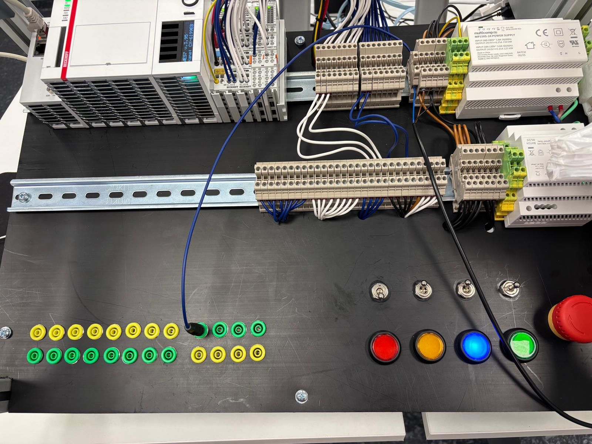
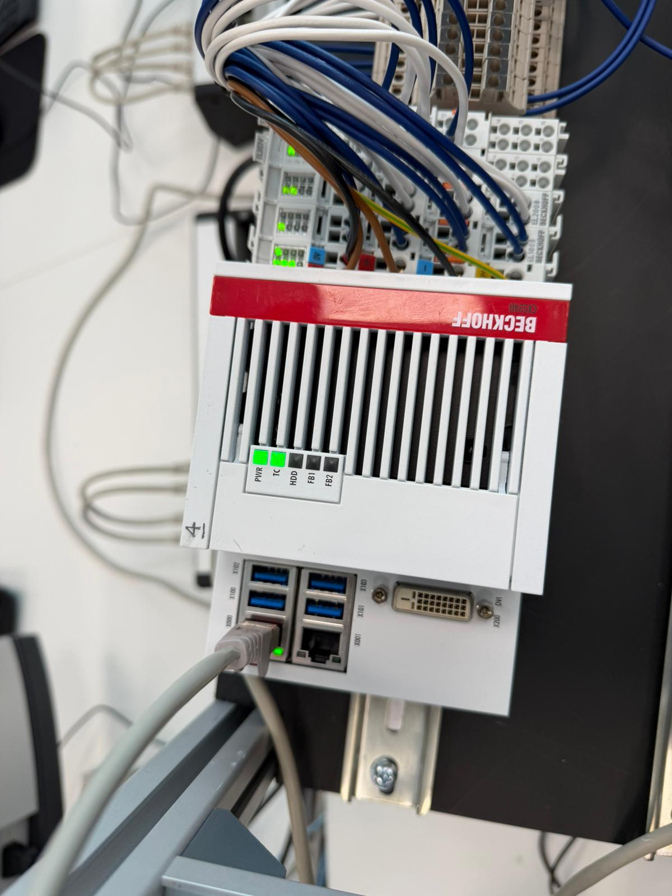
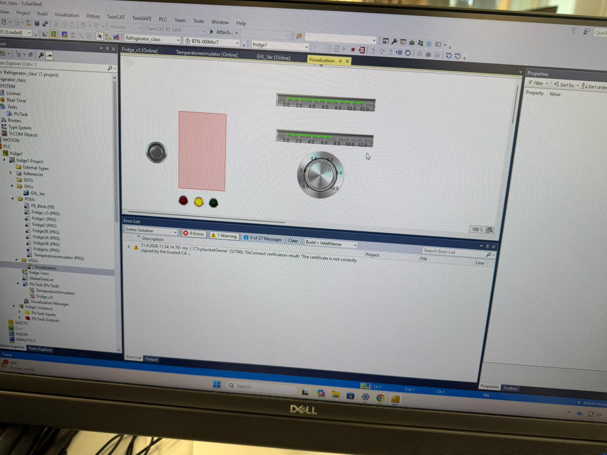
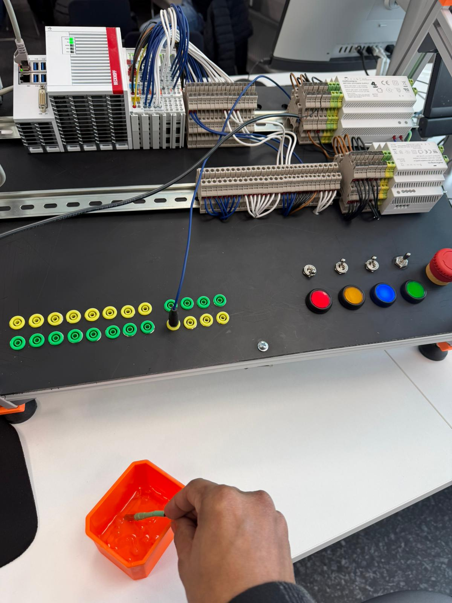
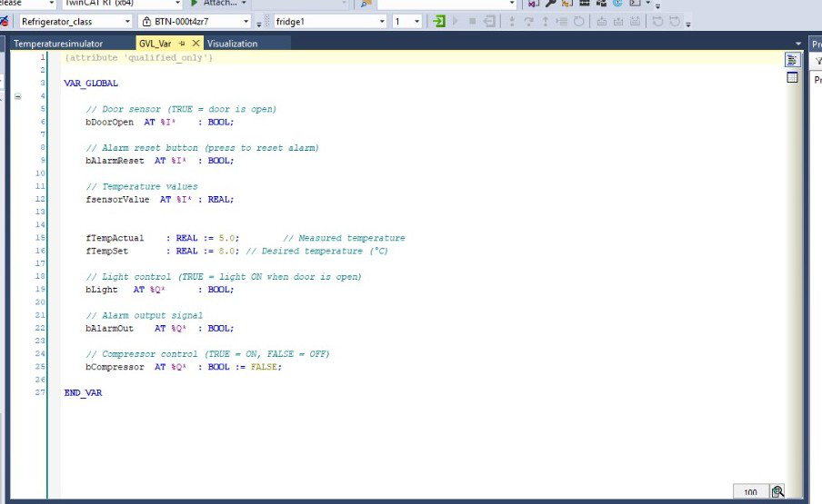
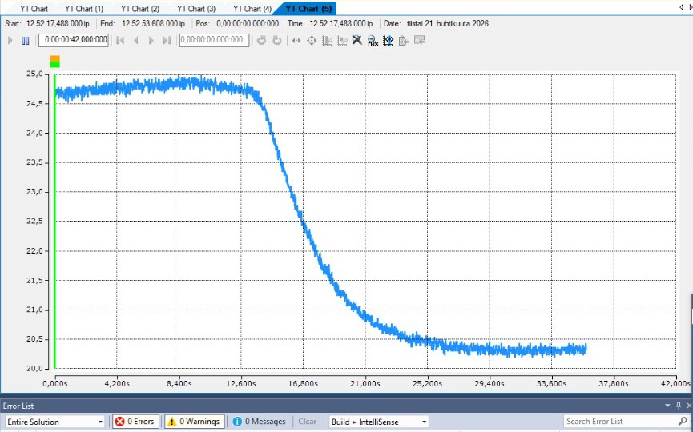
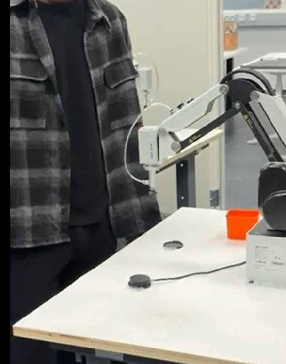
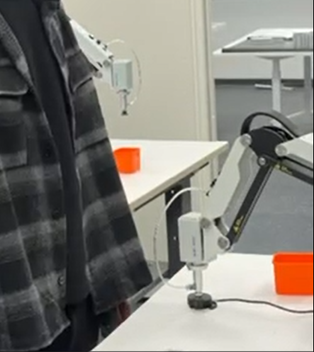

# Refrigerator Control on a Beckhoff PLC

A refrigerator controller written in Structured Text (IEC 61131-3) in TwinCAT 3 and run on a Beckhoff IPC with real I/O. Course work in Control Systems at HAMK (Häme University of Applied Sciences), spring 2026, Group 7.

The controller switches the interior light with the door, raises a door alarm after 10 s, latches the alarm until it is reset, and runs the compressor around a temperature setpoint. In the lab the temperature came from an LM35 sensor and the outputs drove LEDs on the training panel.

## Hardware

| Part | Detail |
|---|---|
| Controller | Beckhoff IPC, TwinCAT Runtime 4024, EtherCAT I/O |
| Digital inputs | EL1008. Toggle switch = door, momentary button = alarm reset |
| Digital outputs | EL2008. Yellow LED = light, red LED = alarm, green LED = compressor |
| Analog input | EL3074, set to 0–10 V and REAL32 |
| Sensor | LM35 temperature sensor, 10 mV/°C, powered from 24 V |
| HMI | TwinCAT VISU: actual temperature and a setpoint knob |

## Programs

The project was built in steps. Each step is its own POU in `Control System/refrigerator_class/fridge1/POUs`:

| POU | What it adds |
|---|---|
| `Fridge1` | Light follows the door |
| `Fridge2` | Door alarm with a TON timer, 10 s |
| `Fridge2B` | Alarm latches and stays on until the reset button is pressed |
| `Fridge3A`, `Fridge3B` | Compressor on when the temperature is above the setpoint (8.0 °C) |
| `TemperatureSimulator` | Compressor control with ±1.0 °C hysteresis. Without hardware, the temperature rises 0.1 °C every 2 s with the door closed and every 1 s with it open |

Shared variables are in `GVLs/GVL_Var.TcGVL`. In the lab version, the inputs and outputs were mapped to the terminals with `AT %I*` and `AT %Q*`:

## Result

Test on 21 Apr 2026: the LM35 was put into cold water while TwinCAT Scope logged the EL3074 value. The reading fell from about 24.8 °C to 20.3 °C in roughly 15 s and then levelled off. The compressor output switched on and off around the setpoint, and the door alarm fired after 10 s with the door open.

## PLC and robot (follow-up lab)

In the next lab the same PLC was wired to a Dobot MG400 with one signal in each direction (EL2008 output 4 to MG400 DI8, MG400 DO8 to EL1008 input 8). The robot moved a part from a pick point to a cooling station, and the PLC released it to the output position once the temperature was low enough.

The PLC program for this lab is not in this repository yet.

## Known gaps

- The repository holds the simulated version of the GVL. The I/O-mapped version is shown only in the screenshot above.
- `TemperatureSimulator` has a cooling timer declared, but the cooling code is not written, so in simulation the temperature only rises.
- `bCompressor` (used by `Fridge3A/3B`) and `bCompressure` (used by the simulator) are two separate variables.

## Open the project

1. Install TwinCAT 3 XAE (build 4024).
2. Open `Control System/refrigerator_class.sln`.
3. Pick the POU to run in `PlcTask`, build, and activate the configuration on a local or remote runtime.

The TwinCAT Scope project with the measurement is in `Control System/TwinCAT Measurement Project1`.

## Team

Group 7: Sazzad Ibna Mahfuz, Ahmad Tanveer, Muhammad Taqi, Pramoda Medis.
